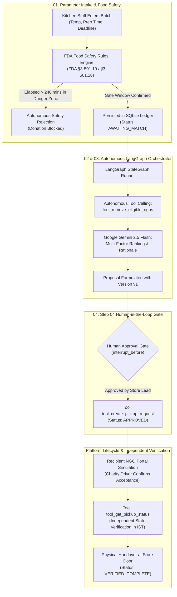

# FoodBridge AI — Autonomous Surplus Food Rescue & NGO Matching Platform

<div align="center">

[](https://foodbridge-ai-uav5.onrender.com/)
[](https://github.com/Manindra-babu/Surplus-Food-Donation-Matcher)
[](https://foodbridge-ai-uav5.onrender.com/api/health)
[](https://foodbridge-ai-uav5.onrender.com/)
[](https://foodbridge-ai-uav5.onrender.com/)
[](https://foodbridge-ai-uav5.onrender.com/)
[](https://github.com/Manindra-babu/Surplus-Food-Donation-Matcher)
[](https://github.com/Manindra-babu/Surplus-Food-Donation-Matcher)

**A production-grade, human-in-the-loop autonomous AI agent that matches perishable surplus food with verified charities, enforces deterministic FDA food-safety policies, and verifies dispatch lifecycles against a persistent mock platform ledger.**

[🌐 View Live Deployment](https://foodbridge-ai-uav5.onrender.com/) • [📖 Interactive Swagger Docs](https://foodbridge-ai-uav5.onrender.com/docs) • [🧪 Test Scenarios Suite](https://foodbridge-ai-uav5.onrender.com/test-scenarios)

</div>

---

## 📌 Executive Summary

Over **40% of prepared food** in commercial kitchens, hotels, and event centers is discarded daily while local charities experience acute meal shortages. Donating hot prepared meals has traditionally been bottlenecked by human coordination delays: perishable food rapidly enters the **temperature danger zone (41°F – 135°F / 5°C – 57°C)** and becomes legally unfit for consumption if not collected within strict safety windows.

**FoodBridge AI** solves this with an autonomous **LangGraph multi-agent architecture**:
1. **Deterministic Safety Gating:** Automatically validates point-of-intake food holding times against **FDA Food Code §3-501.19** (Time-as-a-Public-Health-Control) and **§3-501.16**.
2. **Autonomous Platform Tool Calling:** Calls specialized tools (`tool_retrieve_eligible_ngos`) to evaluate road transit times, dietary compatibility, cold-chain vehicle readiness, and real-time NGO capacity.
3. **Mandatory Human-in-the-Loop Governance:** Enforces a compliance pause (`interrupt_before`) requiring store manager authorization before dispatching.
4. **Independent Ledger Verification:** Executes `tool_get_pickup_status` against the persistent mock platform ledger to audit pickup states without relying on local cache.

---

## 🏛️ System Architecture



---

## 🎯 Hackathon Specification Mapping

FoodBridge AI directly satisfies every requirement specified in the official Hackathon challenge brief:

| Hackathon Requirement | System Implementation | Code / Tool Behind It |
| :--- | :--- | :--- |
| **01. Collect Details** | Ingests food category, quantity, holding temperature, prep timestamp, packaging integrity, and pickup window. | `backend/main.py` & `frontend/src/pages/DonationNewPage.tsx` |
| **02. Plan Next Steps** | Deterministically matches safe holding windows using **FDA §3-501.19 (4-hr TPHC)** and calculates NGO capacity. Blocks spoiled food autonomously. | `backend/rules_engine.py` (`FoodSafetyEngine`) |
| **03. Find Information** | Autonomous tool use: queries database for NGOs with matching dietary requirements, vehicle cold-storage, and active operating hours. | `backend/tools.py` (`tool_retrieve_eligible_ngos`) |
| **04. Take Action** | Mandated Human Approval Gate. LangGraph halts at `interrupt_before=["node_execute_approved_pickup"]` until store lead signs off. | `backend/graph.py` & `backend/tools.py` (`tool_create_pickup_request`) |
| **Output: Pickup Status** | Emits live pickup lifecycle status and logs immutable audit trails with version tracking. | `backend/mock_platform.py` |
| **Check: Confirms Accepted** | Independent status verification tool polls live platform database without relying on stale local state. | `backend/tools.py` (`tool_get_pickup_status`) |

---

## 🧰 Autonomous Agent Tools Directory

The agent interacts with the Mock Donation Platform through dedicated registered tools:

```python
# Available Agent Tools (backend/tools.py)
tools = [
    tool_retrieve_eligible_ngos,   # Queries eligible charities by capacity and constraints
    tool_create_pickup_request,     # Dispatches proposal after human sign-off
    tool_update_pickup_request,     # Amends drop-off destination (triggers approval invalidation)
    tool_get_pickup_status          # Independently audits live platform ledger
]
```

### 1. `tool_retrieve_eligible_ngos`
* **Trigger:** Autonomous execution during Step 03 matching.
* **Function:** Filters candidate charities based on max daily capacity, operating hours, transit time, and cold-chain vehicle requirements (refrigerated vs ambient).
* **Output:** Ranked candidate pool scored out of 100 with Gemini synthesis.

### 2. `tool_create_pickup_request`
* **Trigger:** Invoked only **after** the human store lead approves the proposal in Step 04.
* **Function:** Writes the pickup request to the SQLite platform ledger with idempotency keys and initial version `v1`.

### 3. `tool_update_pickup_request`
* **Trigger:** Recipient NGO requests an updated drop-off location.
* **Function:** Updates destination, automatically **invalidates prior human approval**, increments version to `v2`, and halts until operator reconfirms (TC4 governance).

### 4. `tool_get_pickup_status`
* **Trigger:** Independent status verification call.
* **Function:** Directly polls the persistent database to confirm the live platform state (`PROPOSED` $\to$ `APPROVED` $\to$ `ACCEPTED_BY_NGO` $\to$ `VERIFIED_COMPLETE`).

---

## 🧪 Official Test Scenarios Suite (TC1 – TC4)

FoodBridge AI includes a 1-click automated evaluation suite covering all 4 official hackathon scenarios:

| Scenario | Test Purpose | Expected Result | Actual System Behavior |
| :--- | :--- | :--- | :--- |
| **TC1: Fresh Food Matching** | Standard safe hot meal with sufficient NGO capacity. | Matched, approved, and held awaiting NGO acceptance. | ✅ **Passed:** Food safety validated (45m elapsed), top NGO matched (Score 92/100), human approved, status verified as `APPROVED`. |
| **TC2: Food Prepared Too Long Ago** | Food held > 240 mins in danger zone without temperature control. | Autonomous food-safety rejection without creating dispatch. | ✅ **Passed:** Food prepared 330 mins ago deterministically rejected under FDA §3-501.19. Pickup request blocked. |
| **TC3: Premature Collection Blocked** | Pickup approved by store, but NGO has not yet accepted. | Physical collection blocked until charity confirms receipt. | ✅ **Passed:** Premature collection attempt rejected with 400 guard error. Dispatch remains in `APPROVED (awaiting NGO)`. |
| **TC4: Location Change Invalidation** | Recipient NGO modifies drop-off facility post-approval. | Existing approval invalidated, version incremented, re-approval mandated. | ✅ **Passed:** Drop-off updated, prior approval cleared, version bumped to `v2`, status set to `RECONFIRMATION_REQUIRED`. |

*Run all scenarios in your browser at [`/test-scenarios`](https://foodbridge-ai-uav5.onrender.com/test-scenarios) or via terminal with `python -m pytest backend/test_backend.py`.*

---

## 💻 Tech Stack & Standards

| Layer | Technologies & Standards |
| :--- | :--- |
| **AI & Agent Orchestration** | LangGraph 1.2 (`StateGraph`, `SqliteSaver` checkpoints), LangChain Core, Google Gemini 2.5 Flash SDK (`google-genai`). |
| **Backend & API** | Python 3.11 / 3.13, FastAPI (Async ASGI), SQLAlchemy ORM, SQLite (`foodbridge.db`), Pydantic v2 validation. |
| **Frontend & UI** | React 19, TypeScript, Vite, Tailwind CSS, Lucide React icons, Presentation Wide View mode. |
| **Regulatory Standards** | FDA Food Code 2022 §3-501.19 (Time-as-a-Public-Health-Control), §3-501.16 (Holding Temperatures), Codex Alimentarius. |
| **Timezone Precision** | Indian Standard Time (IST — UTC+05:30) with RFC 3339 UTC backend storage. |
| **Container & Cloud** | Multi-Stage Dockerfile (Node 20 + Python 3.11), Docker Compose, Render Cloud Blueprint. |

---

## 🚀 Quickstart & Local Setup

### Option 1: 1-Click Docker Run (Recommended)

```bash
# Clone the repository
git clone https://github.com/Manindra-babu/Surplus-Food-Donation-Matcher.git
cd Surplus-Food-Donation-Matcher

# Launch complete unified container (serves frontend + backend on port 8000)
docker compose up --build -d
```
* Access Web Application: **`http://localhost:8000`**
* Access Interactive Swagger API: **`http://localhost:8000/docs`**

---

### Option 2: Native Development Setup

#### 1. Backend Setup
```bash
# Create and activate virtual environment
python -m venv venv
# On Windows:
.\venv\Scripts\activate
# On Linux/macOS:
source venv/bin/activate

# Install dependencies
pip install -r requirements.txt

# Start FastAPI server on port 8000
python -m uvicorn backend.main:app --host 127.0.0.1 --port 8000 --reload
```

#### 2. Frontend Setup
```bash
# Open a second terminal
cd frontend

# Install Node dependencies
npm install

# Start Vite dev server on port 5173
npm run dev -- --host 127.0.0.1 --port 5173
```
* Access Local Frontend: **`http://127.0.0.1:5173`**
* Access Local Backend: **`http://127.0.0.1:8000`**

---

### 3. Running Automated Tests

```bash
# Execute complete backend pytest suite (all 13 tests)
python -m pytest backend/test_backend.py -v
```

---

## 📡 REST API Reference

| Method | Endpoint | Description |
| :--- | :--- | :--- |
| `GET` | `/api/health` | Healthcheck and UTC/IST timestamp synchronization |
| `GET` | `/api/donations` | List all registered surplus food batches |
| `POST` | `/api/donations` | Ingest and validate new food batch against FDA rules |
| `POST` | `/api/matching/evaluate` | Trigger LangGraph agent matching and candidate ranking |
| `POST` | `/api/pickups/{id}/approve` | **Step 04:** Provide human store lead approval sign-off |
| `POST` | `/api/pickups/{id}/accept` | Simulate recipient NGO driver confirming dispatch acceptance |
| `POST` | `/api/pickups/{id}/change-location` | Simulate NGO altering drop-off depot (triggers TC4 invalidation) |
| `POST` | `/api/pickups/{id}/verify-completion` | Verify physical driver collection at store doorstep |
| `GET` | `/api/pickups/{id}/verify-status` | **Agent Query Tool:** Poll live mock platform database status |
| `POST` | `/api/test-scenarios/run-all` | Execute all 4 official hackathon evaluation scenarios |

---

## 🔒 Governance, Safety & Auditability

* **No Premature Dispatches:** Pickups cannot execute without human sign-off; physical handoff is blocked until the recipient NGO confirms receipt.
* **Cryptographic Event Trail:** Every lifecycle transition generates an immutable `AuditEvent` with actor identification, version tags, and timestamps.
* **Time-as-a-Public-Health-Control (TPHC):** Adheres to FDA 4-hour temperature safety limits to protect community welfare.

---

## 👨‍💻 Author & Project Links

* **Live Cloud Application:** [https://foodbridge-ai-uav5.onrender.com/](https://foodbridge-ai-uav5.onrender.com/)
* **GitHub Repository:** [https://github.com/Manindra-babu/Surplus-Food-Donation-Matcher](https://github.com/Manindra-babu/Surplus-Food-Donation-Matcher)
* **Author:** Manindra Babu
* **License:** MIT License

---

<div align="center">
  <sub>Built for the AI Agents Hackathon. Empowering community food rescue through intelligent agentic workflows.</sub>
</div>
